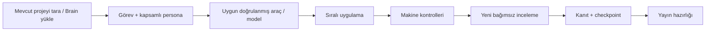

# Store Automation

[](https://github.com/XPersPective/store-automation/actions/workflows/checks.yml)

Flutter projelerini incelemek, geliştirmek ve mağazaya hazırlamak için global bir Codex/OpenCode skill’i. Her proje kendi klasöründe, kendi Git deposu ve Project Brain’iyle çalışır.

## Hemen kullan

Codex’te uygulamanın klasörünü aç ve yaz:

```text
$store-automation Bu projeyi incele, kaldığı yerden devam et ve hataları düzelt.
```

Terminalde aynı proje klasöründen:

```powershell
store-automation
# Belirli bir hedefle:
store-automation start "Bu projeyi incele ve testleri geçen bir sürüme getir"
# Resmî Codex CLI ile:
store-automation start --host codex "Bu projeyi incele ve devam et"
```

Komut, bulunduğun klasörü seçer. Brain varsa yükler; yoksa mevcut dosyaları koruyarak Genesis iskeleti oluşturur. Yeni hedef DRAFT başlar; ürün hedefi uydurulmaz. Mevcut Codex sohbetinde ikinci bir yönetici açılmaz.

## İş akışı



Basit doğrulamalar önce betiklerle yapılır. Model ve persona ayrı seçilir; kalite eşiği token tasarrufu için düşürülmez. Kota/hata sonrası değişiklikler uzlaştırılmadan görev başka modele körlemesine aktarılmaz. Bir projede tek Brain ve tek otomatik uygulama görevi vardır.

## Ajanları gör ve müdahale et

OpenCode görev çalıştırıcısında `run --visible`, gerçek oturumlar için Windows Terminal bölmeleri açar. Yönetici, çalışan ve inceleyen ayrı native oturumlardır; ajanlar durumlarını ana yöneticiye bildirir. Görev tamamlandığında yalnız o görevin sunucusu kapanır, oturum geçmişi ve kanıtlar kalır.

```powershell
store-automation activity
store-automation providers
```

`activity` görev/persona rolü, sağlayıcı/model, süreç durumu ve sağlayıcının bildirdiği token kullanımını gösterir. Bilinmeyen kota ve kullanım alanları bilinmeyen kalır. Codex/Claude/Gemini oturumları kendi native arayüzlerinden izlenir; OpenCode’a zorunlu bağımlılık yoktur. [Canlı ajanlar ve müdahale](skills/store-automation/references/live-agents.md).

## Projeye ait dosyalar

```text
uygulamam/
  .project-brain/       # hedef, mimari, görevler ve devam noktası
  contracts/            # göreve özel persona / izin / kabul ölçütleri
  .factory/runs/        # yerel çalışma kanıtı; Git dışında
  lib/, test/, ...      # uygulamanın kodu
```

Başka projenin görevleri veya oturumları taşınmaz. `adopt` yalnız mevcut projeyi yükler. `bootstrap <yeni-klasör> --name "Ad" --package com.example.ad --platform windows --ads no --pro no` açıkça seçilmiş yeni klasör oluşturur; mevcut projeyi ezmez. Yeni projeler normalde Factory’nin altında değil, diğer projelerin yanında tutulur.

## Şablon ve yayın

napp çekirdeği tema, kalıcı dil seçimi, yerelleştirme, hakkımızda, gizlilik, lisanslar ve mağaza/paylaşım servislerini sağlar. Reklam/Pro modülleri seçmelidir; kapalı modüllerin bağımlılıkları üretilen uygulamaya eklenmez. iOS paylaş/puan ver bağlantısı gerçek App Store ID ister. Bulut veri modu doğru gizlilik metnine bağlanır. Yeni paketler yalnız somut ihtiyaca göre eklenir.

Yayın dosyalarının tek kaynağı `D:/AppPublishing/README.md` protokolü; kaynak projeye ikinci katalog veya gizli bilgi şeması kurulmaz.

```powershell
store-automation release-preflight . --app-id uygulamam --platform android --locale tr-TR --locale en-US
```

Kontrol; kaynak kimliği/sürümü, derleme hash’i, mağaza metinleri ve görsel başlıklarını inceler. İmza, gerçek cihaz, mağaza beyanları, hesap yetkisi ve uzak sürüm ayrıca doğrulanır. Yerel geçiş üretim yayınına hazır kabul edilmez. [Yayın ve gizli bilgi sınırları](skills/store-automation/references/publishing.md).

## Abonelikler ve hesaplar

Resmî CLI’lar kendi abonelik oturumlarını kullanır; API anahtarına otomatik geçilmez. Codex, Claude, Gemini, Qwen, Antigravity ve MiniMax Code envanteri tutulur. Kurulu olmak, oturumun/modelin çalıştığını kanıtlamaz. GLM/Z.ai için doğrulanmış bir headless yol yoksa sistem bunu açıkça engeller. [Güncel envanter ve yönlendirme](skills/store-automation/references/cli-routing.md).

Girişler resmî istemcide kullanıcı tarafından yapılır. Anahtar/parola içerikleri okunmaz veya loglanmaz; Fastlane ve sağlayıcı araçları mevcut güvenli dosya/secret referanslarını tüketir. Aynı Windows kullanıcısına ait bir dosya, tam yetkili bir ajandan teknik olarak gizlenmiş sayılmaz. Kesin ayrım ayrı işletim sistemi kimliği ve sınırlı broker gerektirir; skill bunu varmış gibi göstermez. Üretim/backend işlemleri seçilmiş uygulama, hesap ve işlem yetkisiyle yürütülür.

## Kurulum ve geliştirme

Python 3.11+, Project Brain skill’i ve kullanılacak resmî CLI gerekir. Bu depodan:

```powershell
python tool/install-skill.py
python -m unittest discover -s tests -v
```

Kurulum Codex ve OpenCode skill dizinlerine kendine yeterli kopyalar, kullanıcının `.local/bin` dizinine `store-automation` başlatıcısı yazar. Değiştirilmiş/başkasına ait dosyaları ezmez; global model ayarlarını değiştirmez. `.local/bin` PATH üzerinde olmalıdır; bu bilgisayarda zaten vardır. Yeni skill görünmüyorsa yeni sohbet/terminal aç.

Bu bilgisayarın varsayılanları: starter `D:/repositories/napp_app_template`, core `D:/repositories/napp-core`, publishing `D:/AppPublishing`. Başka kurulumlarda `STORE_AUTOMATION_STARTER`, `STORE_AUTOMATION_KIT`, `STORE_AUTOMATION_BRAIN` (brain.py yolu) ve preflight’ın `--publishing-root` seçeneği kullanılabilir. Çalışma sırasında bu araç geliştirme deposuna ihtiyaç yoktur.

CI, haricî hesap/SDK gerektirmeyen süreç ve yayın kontrollerini çalıştırır; tam yerel entegrasyon yukarıdaki test komutuyla doğrulanır. Android cihaz/derleme, iOS/macOS, canlı mağaza/receipt ve sağlayıcı girişleri ayrı kanıt kapılarıdır. [Doğrulama raporu](docs/report.json).

Global yükleyici kurulu araçların resmî skill yollarını keşfeder; `python tool/install-skill.py --list` önizler, argümansız yükleyici bütün doğrulanmış hedefleri kurar. Claude, Gemini, Qwen, OpenCode, Codex, MiniMax, MiMo, Antigravity ve ortak agents keşfi desteklenir. Sadece klasör izi kurulum kanıtı sayılmaz; bilinmeyen araç için dizin uydurulmaz.

Canlı durum varsayılan olarak Türkçedir: **Yönetici / Uygulayıcı / İnceleyen**. `--language en` İngilizce, `--json` makine çıktısı verir. Eski planı koruyarak sürdürmek veya yedekleyip yeniden denetlemek için [yaşam döngüsü](skills/store-automation/references/lifecycle.md); ücretsiz iOS derleme/ekran kanıtı ve güncel mağaza kapıları için [iOS rehberi](skills/store-automation/references/ios-ci.md).


Store Automation 2.2.0: uzman görev/persona ve sonuç sözleşmesi, resmi CLI envanteri, taze ortak kota pencereleri ve risk tabanlı model/efor seçimi. `providers --scan`, `route --inventory` ve `usage --record ... --expected ...` bilinmeyen erişim/kullanımı başarı saymaz. Claude ve Qwen mevcut kullanıcı tercihleriyle kapalıdır. Dağıtım merkezi Skills Manager üzerinden yapılır; kaynak paket `python tool/install-skill.py --target .factory/distribution/store-automation` ile güncellenir, sonra `skills-manager-cli skills update store-automation` dağıtımları yeniler. Template/core reposu bu pakete alınmaz.

Gerçek Codex sağ panel ajan terminali bağlantısı PB-019 altında doğrulanmamıştır. Son kullanıcı talebi güzel Windows Terminal konsoluna izin verir; değişken ajan sayısı, kalıcı başlıklar ve koyu hazır tema desteklenir. Bu ayrı Codex panel bağlantısının kanıtı değildir. Antigravity yeni native adapteri doğrulanmamış yazma scope'unu reddeder; erişim probe'u görev yeteneği/başarısı değildir. Mevcut host uzmanları kaynak işi için kullanılabilir; UI/hesap kanıtı ayrıca gerekir.


2.1.0: her skill başlangıcında otomatik CLI/abonelik/ücretsiz/API katalog araştırması,
koordinatör+çalışan kota kontrolü; platform/mağaza/ücret/reklam yerleşimi/lisans/hariç
özellik/veri/billing intake, ürün ana-alt aşamaları ve devir checkpoint'i. `providers
--scan` OpenCode ve opsiyonel OpenRouter güncel metadata listelerini okur;
`--local-only` uzak kataloğu atlar. Model listesi erişim veya kalite kanıtı değildir.
Paylaşım/lisans gibi generator switch'i olmayan tercihler uygulama görevine dönüşür.
Bootstrap seçilen platformu gerçekten generator'a iletir; yeni kaynakta Windows-only
üretim kontrolü vardır. 2.2.0 desteklenen OpenCode mesaj aktarımını ve Codex kota adapterini ekler; diğer hesapların adapterleri ve native görsel kabul kapısı açık kalır.


2.2.0 çalıştırılabilir kapılar: başlangıçta otomatik katalog taraması ve taze Codex
model/efor/ortak kota; AGY+Codex yönlendirme; dönen görev raporunun şema/kimlik
kontrolü; OpenCode native mesaj/durdurma ve yöneticinin sonraki turuna noReply
bildirim aktarımı. Bilinmeyen hesap/transport desteği kullanılır kabul edilmez.
`start --host auto` uygun doğrulanmış koordinatörü seçer; `open` taramadan sonra
OpenCode TUI açar, kendiliğinden görev çıkarımı başlatmaz. Yayın paketi runtime'ı
birlikte taşır, napp temaları dış kaynakta kalır.

Yükseltme: mevcut Skills Manager kaydında `skills-manager-cli skills update store-automation --json`. Proje kaynakları ve Brain kayıtları korunur; owned-manifest runtime yükselticisi değiştirilmiş/sahipsiz dosyaları ezmeyi reddeder. Yeni oturum skill sürümünü yeniden yükler.
