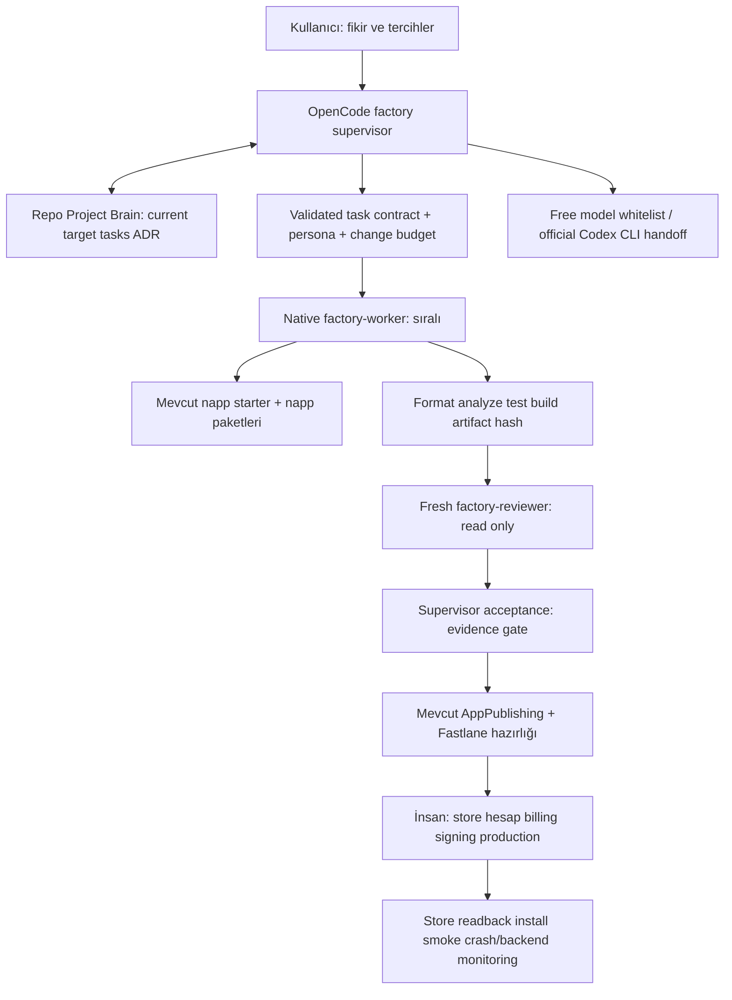

# AI App Factory — mimari kararları (2026-10-10)

Bu belge kurulumdan önce yapılan üç eleştiri turudur. Puanlar ölçüm değil,
karşılaştırmalı mühendislik değerlendirmesidir. Kabulü test kanıtı belirler.

## Keşif ve gerçek sınırlar

- OpenCode 1.17.18; global model qwen-cloud/qwen3.8-max ama provider disabled.
  qwen-paytopay API credential mevcut; fabrika bu yolu kullanmaz.
- Codex resmi CLI ChatGPT oturumuyla giriş yapmış; Claude Code first-party OAuth.
  Gemini CLI PATH'te yok. Credential içerikleri okunmadı.
- Flutter 3.47.2 / Dart 3.13.2; Windows, Android SDK ve emülatör var.
  Bazı Android lisansları kabul edilmemiş. macOS/Xcode yok.
- Hafif starter: D:/repositories/napp_app_template,
  origin https://github.com/XPersPective/napp_app_template.git, başlangıç 7101480.
- Ortak paketler: D:/repositories/napp-core,
  origin https://github.com/XPersPective/napp_kit.git, başlangıç 4977cf0.
- Project Brain 2.1.0: C:/Users/rubicon/.skills-manager/skills/project-brain.
  Tek repo Brain, Git history, PB new/boot/validate zaten mevcut.
- Yayın protokolü D:/AppPublishing/README.md. Yeni yayın şeması yasak;
  mevcut publisher/apps yolları ve StorePublishMatic ayarları kullanılacak.
  StorePublishMatic deposunda başka çalışmaya ait dirty dosyalar var; korunacak.
- GitHub CLI login yok. Yerel Git kopyaları mevcut; remote freshness belirsiz.
- Starter Pro yalnız lifetime; ortak standardın 'abonelik YOK' kuralı yeni
  şartnameyle çatışıyor. Yeni ürünlerde kullanıcı kararıyla monthly eklenebilir;
  eski lifetime akışının davranışı korunur.
- Kaynak incelemesi: ads-only template ProController'a başvuruyor; template
  Pro → AdPolicy bağlantısı eksik; OtherApps listesi platforma göre süzülmüyor;
  PurchaseRepository ürün filtresini uygulamıyor. Stable template kapısı kapalı.

## Tur 1 — başlangıç önerisinin eleştirisi → V1

Başlangıç puanı: 6/10. Güçlü yönler: kanıtlı kabul, ücretsiz öncelik,
mevcut template/Brain/Fastlane korunması, sıralı yürütme, insan yayın kapısı.
Zayıflıklar: her task için ikinci Brain aynı gerçeği iki yerde tutuyor; çok
sayıda persona kalıcı ajan demek değil; sekiz adapter henüz gerçek ihtiyaca
dayanmıyor. Native subscription erişimi garanti değil. Bir CLI exit 0 review
PASS anlamına gelmez. Provider migration veri taşıma ve security değişikliğidir;
quota bitti diye otomatik backend migration yapılmaz. Premium sözcüğü tek başına
kabul kriteri değildir. Shell erişimi credential/deploy sınırını aşabilir.

V1 (7/10): OpenCode primary supervisor + bir worker + ayrı reviewer.
Tek Project Brain; task kontratları PB task'a bağlı stateless JSON girdileri.
Build/lint/test/hash işleri script. Native task/skills/commands/permissions.
Uygulama ihtiyacı yokken backend kurma. Mevcut Fastlane protokolüne referans.
Model seçimi native ücretsiz whitelist ve resmi subscription CLI ile yapılır.
Görsel/security/release persona kontratta seçilir; ayrı uzun ajan promptu yok.

## Tur 2 — V1 eleştirisi → V2

V1'in sorunları: prompt içindeki no-paid kuralı yanlış model çağrısını fiziksel
olarak engellemez. Reviewer aynı session'da bağımsız değil. Artifact eski commit'e
ait olabilir. CLI crash yarım değişiklik bırakabilir; başka modele doğrudan aynı
görevi vermek duplicate iş yaratır. Git conflict/corruption sırasında mutasyon
durmalı. Registry'de güçlü/vision varsayımı ölçülmeden yazılamaz. Ücretsiz model
veri saklama şartları değişebilir. Yanlış persona yüzünden review kapsamı eksilebilir.

V2 (8/10): repo-local OpenCode config ile factory scope; ücretsiz model allowlist,
diğer sağlayıcılar kapalı; resmi CLI çağrısından önce subscription login kontrolü,
API/gateway environment kaldırma. Global model config korunur. Reviewer write ve
shell yetkisi olmadan yeni child session. Deterministik evidence: komut/exit,
commit, artifact SHA256, reviewer verdict, supervisor acceptance. Bir aktif
PB task; crash sonrası boot + Git diff + test → handoff; otomatik tekrar yazma yok.
Quota/timeout availability fallback ile quality escalation ayrılır. Geçerli
ücretsiz eşdeğer yoksa BLOCKED, ücretliye geçiş yok. Capability bilgisi doğrulanma
tarihli; vision sınanmadan visual QA PASS yok. Backend seçimi kısa ADR + güncel
kota kaynağı + usage ceiling + backup; auth/RLS/failure testi olmadan kabul yok.

## Tur 3 — V2 eleştirisi → V3

V2'nin sorunları: tam genel workflow engine yeniden yazmak bakım yükü getirir.
JSON kontrat bir ikinci görev state makinesi olmamalı. Serbest komut çalıştıran
wrapper permission sınırını zayıflatır. Shell glob gerçek sandbox değildir.
Subscription CLI'nin yerel ayarları ücretli gateway'i seçebilir; auth kontrolü
yeterli olmayabilir. Ücretsiz endpointlerin 'free' adı kalıcı fiyat garantisi
değildir. Sahte quota simülasyonu canlı sağlayıcı failover kanıtı değildir.
Mağaza receipt doğrulama backend'i olmadan client monthly satın alındı sinyali
lifetime'a çevrilmemeli. License/private repo kararı ürün başına yapılmalı.

V3 (8.5/10): orchestration native OpenCode'da, state yalnız Brain'de. Az bir
Python stdlib CLI yalnız gerçek boşlukları kapatır: kontrat validation,
onaylı model planı/CLI dispatch, izole template bootstrap, hash bağlı evidence
gate ve local release preflight. Genel servis adapter/fsm/database/n8n yok.
Model runner fixed argv kullanır; arbitrary shell endpoint yok. Codex kendi
ChatGPT auth'uyla, user config/gateway bypass edilerek read-only review/resume
çalışır. Claude otomatik kullanım opt-in; extra usage billing kesin bilinmeden
ücretsiz fallback sayılmaz. OpenCode ücretsiz endpointi yalnız allowlist'ten.
Monthly production verified expiry/revocation gerektirir; backend/store erişimi
yoksa fail closed ve açık BLOCKED, sahte prod verifier yok.

## Final Recommended Architecture

V1'in üç rolü, V2'nin kanıt ve recovery sınırları, V3'ün küçük araç katmanı.

### Sorumluluk ve state sınırları

- Supervisor: intake, dependency order, model/capability seçimi, persona,
  tek aktif görev, acceptance, Brain yazma ve checkpoint. Worker implement eder.
- Worker: kontrat kapsamı, self-review, test kanıtı; Brain'i yeniden planlamaz,
  ödeme/deploy/signing/silme yapmaz; yeni bulguyu supervisor'a döndürür.
- Reviewer: source/evidence okuyarak architecture/code/security/visual/release
  review persona'sını uygular. Edit, bash, task ve deployment kapalı.
- Kontrat: objective/persona/context/dependencies/scope/out_of_scope/tools/
  permissions/quality/acceptance/evidence/deliverables/failure/handoff.
  Persona role/expertise/objective/quality/tools/permissions/forbidden/failures/
  acceptance içerir. Kontrat PB task'ın state'ini kopyalamaz.
- Brain canonical PB statüleri kullanılır: PLANNED READY IN_PROGRESS BLOCKED DONE.
  REVIEW/REWORK worker sonucu; ikinci mutable state deposu oluşturulmaz.
- Git history tamamlanan işleri tutar; evidence dosyaları komut çıktısıdır.
  Başka repo kendi Brain'ini taşır; her küçük task'a nested Brain yok.

### Model yönlendirme ve recovery

SIMPLE: dar deterministic araç + gerekirse ücretsiz native worker.
STANDARD: native worker; COMPLEX/SPECIALIZED: güçlü resmi subscription CLI veya
capability kanıtlı model. Görsel görevde screenshot + vision zorunlu.
Ücretsiz küçük model karmaşık görevi review geçmeden bitiremez.
Bu kurulumda native default space-bunny-free; ücretsiz yedek longcat-2.5-preview-free.
Bu seçim anlık resmi pricing ve local catalogue'a dayanır; kalıcı SLA yoktur.
Endpoint kaldırılırsa whitelist fiyat kontrolüyle insanın yerel güncellemesi gerekir.
Codex ChatGPT CLI alternatif olarak kullanılabilir; Claude login var ama extra
usage kontrolü yapılmadığı için otomatik fallback kapalı; Gemini unavailable.

Fallback: checkpoint → boot → doğrula → mevcut diff/başarılı kanıtı devret →
eşdeğer capability'li ücretsiz model. Timeout/CLI crash/provider/auth/quota farklı
hatalardır; auth fail retry yok, generic failure ücretli modele gönderilmez.
Quality failure: farklı bağımsız reviewer + daha güçlü uygun model; test bypass yok.
Network yoksa online görev BLOCKED, offline test/scope işleri ilerler. Git merge
conflict/corruption: mutasyon yok, önceden alınan bundle/archive korunur.
Bounded timeout, bir provider denemesi, kalıcı log; sonsuz retry yok.

### Service router ve maliyet

Default local/no backend. ADR adayları capability bazlı:
Cloudflare edge/D1/R2/queues; Firebase FCM/mobile diagnostics/auth;
Supabase Postgres/auth/RLS/realtime; Appwrite auth/storage/functions;
PocketBase local/self hosted; Neon Postgres; Turso libSQL.
Fiyat/kota/region/backup/maintenance/SDK/offline/account koşulları yeni app intake
sırasında resmi kaynaklardan tarihli doğrulanır. Factory tümünü deploy etmez.
Bir servis yeterliyse ikinci eklenmez; FCM + edge gibi gerçek ihtiyaçta kombinasyon.
Free-tier limit aşımı: durdur/limit/offline degradation; migration ayrı task ve
veri/security review, ücretli geçiş yalnız açık onay. Hiçbir billing açılmaz.

### Ölçülebilir premium kapılar

| Görev | Zorunlu kabul |
|---|---|
| Architecture | sorumluluk/data flow/state/error/offline/provider/observability/security ADR; bağımsız PASS |
| Code | formatter diff yok; fatal lint/analyze 0; test 0 failure; kapsam dışı diff yok |
| UI | gerçek screenshots light/dark, phone/tablet/landscape; text scale 1.3 ve 2; overflow yok; en az 48dp target; normal text kontrast 4.5:1; loading/empty/error; screen-reader QA |
| Performance | app spec'te cihaz ve startup/frame/bundle bütçesi; ölçülen artifact; varsayımsal PASS yok |
| Backend | auth+authorization isolation negatif test; invalid input; timeout/offline; observability without PII; backup restore |
| Monetization | free excludes SDK; banner premium'da yok; rewarded user intent ve tek ödül; pending/cancel/error/restore; monthly expiry/revocation/lifetime priority |
| Release | package/version/artifact/hash/signing doğrulama; güncel store declarations; gerçek platform screenshot; insan yayın yetkisi |

Artifact gate source hash ve test exit 0 ile bağlıdır; screenshot varlığı tek başına
görsel kalite demek değildir. Worker ve reviewer farklı session kimlikleri;
supervisor machine gate'ten sonra kabul kaydı üretir. Gitleaks mevcutsa kullanılır;
yoksa dar secret scan tam security garantisi sayılmaz. Prompt/glob izinleri OS
sandbox değildir; credential kökü factory agent'larına kapalı, release protokolü
yalnız gereğinde yetkili ayrı oturumda okunur.

### Release ve rollback

Release hazırlığı D:/AppPublishing/README.md'ye bağlı; yeni katalog/protokol yok.
Factory dry-run yerel readiness kontrolüdür; Fastlane'de evrensel --dry-run yok.
Gerçek Fastlane sadece yan etkisiz smoke lane ile test edilir. Production lanes
factory ajanlarında çalıştırılmaz. StorePublishMatic'in mevcut runner/readiness
akışı kullanılır; paid AI inspector yerine offline kurallar seçilir.
iOS local build Windows'ta BLOCKED_BY_ENVIRONMENT. Signing/account/ürün oluşturma,
monetization production config ve destructive migration insan kararıdır.
Store status readback + production install/smoke/crash/backend ölçümü olmadan
yayın tamamlanmaz. Rollback: owned commits revert; build hash'li önceki artifact;
metadata backup; config backup; store rollback policy uygulama başına planlanır.

### Alternatifler ve karar soruları

OpenCode burada en uygun ince merkez: zaten kurulu native agents/task/skills ve
provider seçimi var. Evrensel olarak en iyi olduğu kanıtlanmış değildir. Codex
CLI tek başına daha az parçalı ve bu kullanıcının subscription yolunda daha sağlam
fallback; çok provider UI isteğinde OpenCode korunur. Aider pair coding için,
OpenHands sandbox/server operasyonunda, n8n business event entegrasyonunda yararlı;
bu repo için ek engine/dependency kanıtlı ihtiyaç değil.

1. Fikir doğru yönde; kanıt ve maliyet sınırları kurulmadan otonom yayın yanlış.
2. Orchestrator tek repo Brain; worker ilgili slice okur; nested task Brain gerekmez.
3. Trivial format/hash/build için Brain ve AI gereksiz; task kanıtına sonuç eklenir.
4–7. OpenCode seçilir; custom orchestration ve n8n kurulmaz; ince validation CLI yeterli.
8. Üç rol yeterli, persona göreve göre; ayrı 15 uzman ajan gerekmez.
9. Build/lint/tests/hash/command validation/version/package checks AI'dan çıkarılır.
10. Provider sınırı gerçek backend/SDK katmanında; hayali ortak cloud API yok.
11. Free-first düşük kullanımda sürdürülebilir; SLA/limits/monitoring garantisi yok.
12. Spec+data flow+design tokens+failure states+test/device budget+scope preflight.
13. Üç büyük risk: subscription/fiyat değişimi; receipt doğrulaması; stale evidence.
14. Minimum prototip: contract → native delegation → Brain checkpoint/resume →
    independent review → gerçek template analyze/test/APK.
15. Bu MVP ve monetization/platform regression geçmeden production gate açılmaz.

## Resmi kaynaklar (10 Ekim 2026 kontrolü)

- [OpenCode agents](https://opencode.ai/docs/agents/),
  [permissions](https://opencode.ai/docs/permissions/),
  [skills](https://opencode.ai/docs/skills/),
  [config](https://opencode.ai/docs/config/), [commands](https://opencode.ai/docs/commands/).
- [OpenCode Zen pricing/privacy](https://opencode.ai/docs/zen/): seçili ücretsiz
  modeller geçici; ücretli listedeki modeller fabrika allowlist'inde yok.
- [Claude Code legal](https://code.claude.com/docs/en/legal-and-compliance):
  kendi subscription ile unmodified resmi CLI; token aktarımı yok.
- [Codex authentication](https://developers.openai.com/codex/auth): ChatGPT login;
  yerel codex login status da ChatGPT doğruladı.
